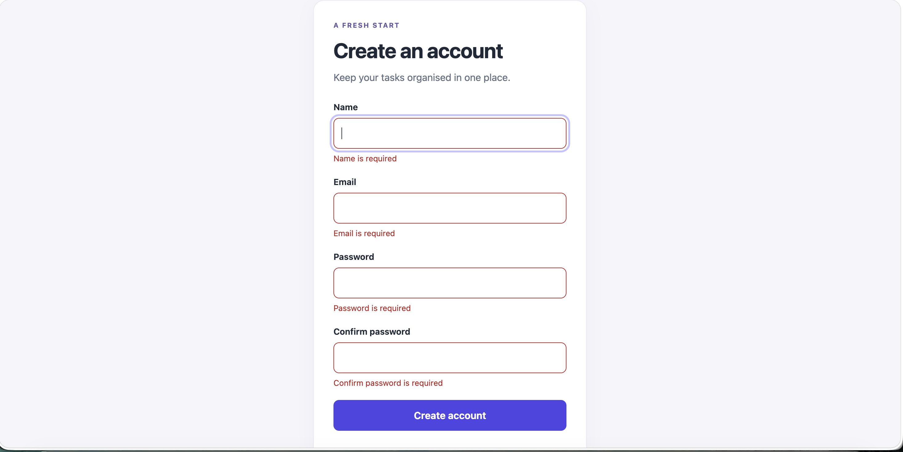
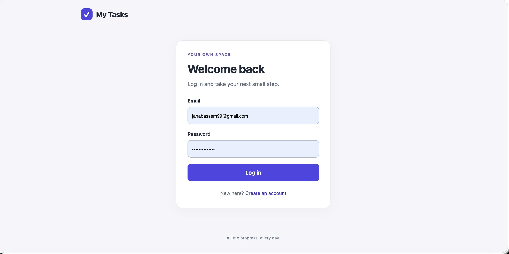
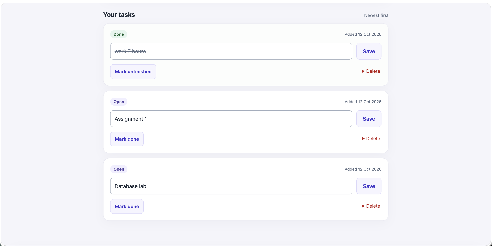
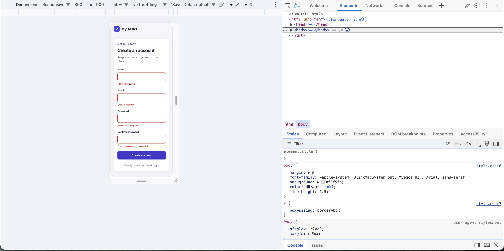

# Login & To-Do Application

A small Flask application with registration, login, server-side sessions and a private MySQL to-do list.

## Student and contributions

- Name: Jana Bassem Said
- Student ID: 2304066
- Group: 1
- Team: Individual submission
- Contribution statement: I completed this project as an individual submission. I used an AI assistant for environment setup, explanations, debugging guidance, and assistance generating application code. I personally entered and executed the MySQL schema, configured the database connection, assembled the project files, and tested the application’s features. For languages and tools unfamiliar to me, I used the assistant’s guidance to understand how the components work together. I reviewed the code carefully, with particular attention to the MySQL tables, constraints, queries, and relationships.

## Technologies

- Backend: Python 3, Flask, PyMySQL, bcrypt, Flask-Session, CacheLib, python-dotenv.
- Frontend: HTML, CSS, JavaScript and Jinja templates.
- Database: MySQL, database `registration`, tables `users` and `todos`.
- Plain SQL is used. There is no ORM. Session data is stored locally in `instance/sessions`; it is not stored in a third MySQL table.

## Run from an empty Mac

1. Install Python 3.11 or newer from https://www.python.org/downloads/macos/ . Python 3.14 was used during development. Install MySQL Server from https://dev.mysql.com/downloads/mysql/ and start it. Record your MySQL username and password. DBeaver can be installed from https://dbeaver.io/download/ to run the SQL visually. Install Git if needed using the macOS command-line tools (`xcode-select --install`). VS Code is an optional editor.
2. Download and extract this repository, or clone its actual GitHub URL. Open its top-level folder (the folder containing `app.py`) in VS Code and choose Terminal > New Terminal.
3. Create and activate an environment:

   ```bash
   python3 -m venv .venv
   source .venv/bin/activate
   python -m pip install -r requirements.txt
   ```

4. Open `database/schema.sql` in DBeaver using a MySQL connection and execute the whole script. **The script deletes and recreates `registration`, including existing accounts and tasks.** Run it for initial setup or a deliberate reset, not at every application startup. It can be run repeatedly. If the MySQL command-line client is available, an alternative is:

   ```bash
   mysql -u root -p < database/schema.sql
   ```

5. Create your local settings file:

   ```bash
   cp .env.example .env
   ```

   Edit `.env`, replacing the example database credentials with your MySQL settings. Keep `DB_NAME=registration`. If the account really has no password, use `DB_PASSWORD=""`. Generate a new secret:

   ```bash
   python -c "import secrets; print(secrets.token_hex(32))"
   ```

   Paste that output after `SECRET_KEY=` in `.env`, then save. Never upload `.env` to GitHub. `.env.example` contains placeholders only.

6. Check the connection:

   ```bash
   python check_db.py
   ```

   Expect `Connected to: registration`, followed by `todos` and `users`.

7. Start the server:

   ```bash
   python app.py
   ```

8. Open http://127.0.0.1:5001/register in a browser. Create an account. Registration logs you in automatically. Keep the terminal running. Stop the server using Control+C. After Python edits, stop and restart it; debug mode is off.

For later sessions, activate `.venv` and run `python app.py`. Do not rerun the schema unless you intend to erase the lab data. The Flask development server is for the local lab demonstration.

## Features

| Requirement | Implementation |
|---|---|
| R1 | Registration with name, email, password and confirmation; duplicate email gives `Email Already Exists`; successful registration signs in and opens tasks. |
| R2 | Email/password login; both unknown email and incorrect password give `Invalid email or password`; logout clears the server-side session. |
| R3 | All task routes require login; lists contain only the session user's tasks, newest first. |
| R4 | Add a task with a title. |
| R5 | Edit a task title using Save. |
| R6 | Mark done or unfinished. |
| R7 | Delete opens an “Are you sure?” section before the separate confirmation button. This also works without JavaScript; click Delete again to close it without deleting. |
| R8 | Browser and server validation with the lab's exact messages. Invalid titles re-render the list using a read-only SELECT; no data changes. |
| R9 | bcrypt hashes with cost 12; parameterized PyMySQL queries; ownership IDs only from the session. |
| R10 | Shared styling, responsive layout, clear errors, completed-task styling, empty state, name and logout. |

Additional features: open-task count (a listed bonus option), automated application tests, and CSRF tokens on forms. Bonus credit is subject to TA assessment.

Extra length checks avoid database errors for names over 100 characters and emails over 255 characters. bcrypt accepts at most 72 UTF-8 bytes, so both browser and server reject longer registration passwords with a clear message rather than truncating them. Passwords are never trimmed. Names, emails and task titles are trimmed; emails are lowercased. Email format beyond the lab's required-field rule is not additionally enforced.

## Project files

```text
app.py                       Routes, validation, sessions and SQL
check_db.py                  Read-only MySQL connection check
requirements.txt             Python dependencies
.env.example                 Fake/example settings
.gitignore                   Excludes local secrets and generated files
database/schema.sql          Re-runnable DDL, no data
templates/base.html          Shared header and layout
templates/register.html      Registration form
templates/login.html         Login form
templates/todos.html         Private task list and forms
templates/error.html         Friendly error page
static/style.css             Shared responsive styles
static/validation.js         Browser validation and Cancel button
tests/test_app.py            Automated application behaviour tests
screenshots/README.md        Required screenshots to capture
```

## Screenshots — complete before submitting

### Registration validation


### Login


### To-do list


### Mobile layout


## Answers to the lab questions

### (a) Why does UPDATE/DELETE include AND user_id = %s?

The task ID comes from the browser and can be changed by the user. The second condition requires the task's owner to match the authenticated user's ID from the server-side session. Removing it would let an authenticated user change or delete another user's task by supplying its ID. PyMySQL uses `%s` for the handout's `?` placeholder. Values are passed separately to `execute`, never glued into SQL text.

### (b) What if the task's user_id does not exist?

MySQL rejects the insert because `todos.user_id` is a foreign key referencing `users.user_id`. This enforces referential integrity: each task must reference an existing account.

### (c) Why store a hash instead of the password?

A password hash lets the server verify a typed password without keeping its original text. If the database is exposed, plaintext passwords would be immediately readable. bcrypt uses a salt and deliberately expensive computation to make password guessing harder. The library verifies the submitted password against the stored hash; the application does not decrypt a hash.

### (d) Why check an empty name despite NOT NULL?

`NULL` represents a missing database value. Empty text (`''`) and spaces are still values, so `NOT NULL` accepts them. The application trims and checks the name to reject empty or spaces-only input.

Read and understand these answers and express them in your own words when explaining the project.

## Verification

Run automated tests from the project root with the environment active:

```bash
python -m unittest discover -s tests -v
```

The tests cover validation, duplicate accounts, hashes, login failures, SQL-injection input, CRUD, ownership checks, session invalidation, CSRF and escaped HTML. **They use an isolated in-memory SQLite adapter in place of the MySQL connection.** This avoids changing your actual data but does not verify MySQL DDL or its driver. The actual application uses only MySQL. Run `check_db.py` and the manual checks below against your real MySQL setup as well.

Manual checks:

- Run the schema twice on a disposable/resettable lab database; both runs should succeed. MySQL may display a display-width deprecation warning for the lab's `TINYINT(1)`.
- Visit `/todos` without login; expect `/login`.
- Submit an empty registration form. Verify all four messages appear before a request is sent. Disable JavaScript, reload, and submit again; the server must show the same messages.
- Register, then logout. Register the same email again; expect `Email Already Exists`.
- Try unknown email and wrong password; both show `Invalid email or password`.
- Try `' OR '1'='1' --` as a login email; it must not sign you in.
- Add, edit, complete, uncomplete and delete tasks. Verify newest-first order and the open-task count.
- Add/edit blank titles, spaces-only titles, 200-character titles and 201-character titles. The first two and last must be rejected; 200 is allowed.
- Open two separate browser sessions with different accounts. Each must see only its own tasks. The automated ownership test submits another user's task ID for edit/toggle/delete and a forged user_id for add.
- Inspect `SELECT password_hash FROM users;` in DBeaver. Values should be bcrypt hashes, not passwords.
- Test at 360px width and capture the screenshots listed above.
- A refresh after a successful POST must not repeat the action: the server redirects after success.

## GitHub delivery

After reviewing the files, filling the contribution statement, capturing screenshots and testing:

```bash
git init
git add .
git status
git commit -m "Add login and private to-do application"
```

Before committing, verify `.env`, `.venv` and `instance` are not staged. Create an empty GitHub repository, use its actual URL with `git remote add origin YOUR_REPOSITORY_URL`, then `git branch -M main` and `git push -u origin main`. Use the URL supplied by GitHub, not the literal placeholder. Make subsequent commits for genuine improvements and fixes. If private, share with the TA usernames provided by your course. Do not invent past commits or contributions.

## Common problems

- `Access denied`: match `.env` to your working DBeaver username/password, save, and rerun the connection check.
- Missing `SECRET_KEY`: add the generated secret to `.env` and save.
- `No module named ...`: activate `.venv` and install `requirements.txt`.
- `TemplateNotFound`: `templates` must be beside `app.py` and contain all five HTML files.
- “This form has expired”: reload the form after logout, session expiry or a server/session reset, then try again.
- `Address already in use`: stop the earlier Flask terminal using Control+C before starting another server on port 5001.
- A website favicon 404 does not affect the task features.
